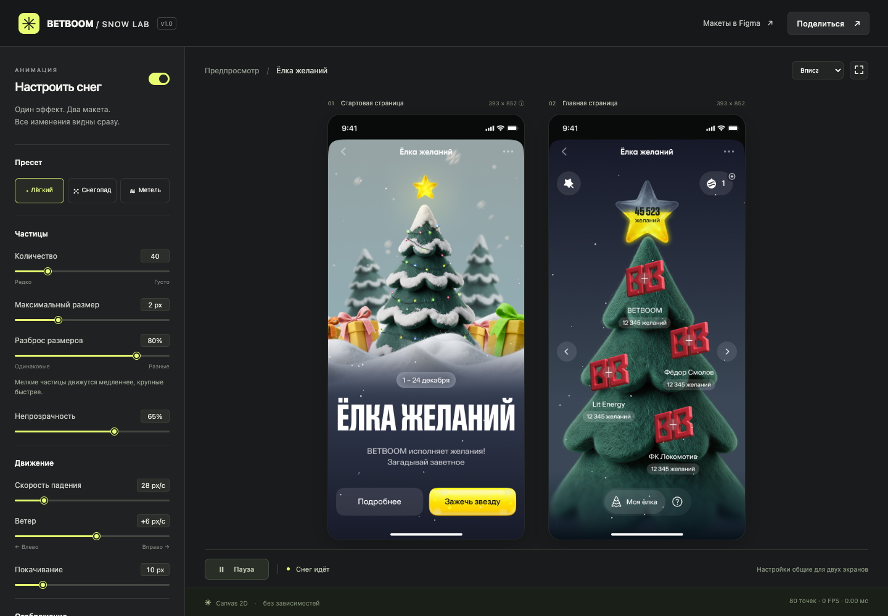
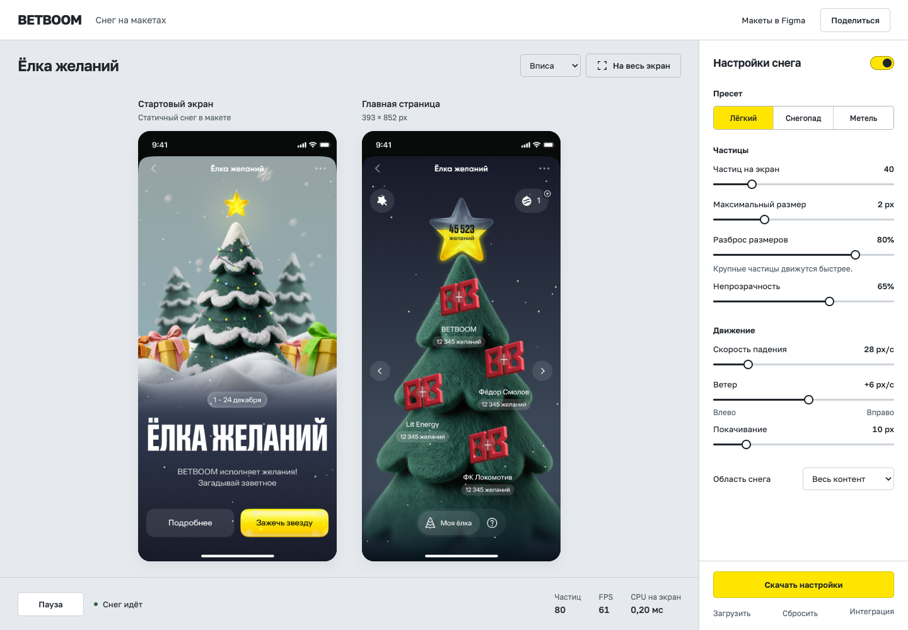
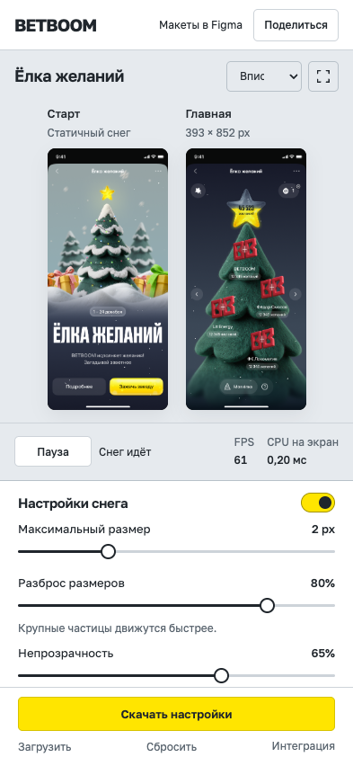

# Дизайн-аудит стенда снега

Дата: 22 октября 2026 года. Исходная версия: 4547a6b. Метод: frontend-design, просмотр исходников и браузерные снимки на 1440 × 1000 и 393 × 852.

Задача стенда: сравнить снег на двух готовых макетах, настроить его и передать конфигурацию разработчикам. Аудит оценивает этот сценарий, а не оформление самих макетов.

## Что мешает работе

| Приоритет | Наблюдение | Изменение |
| --- | --- | --- |
| Высокий | На телефоне при переходе к разбросу размеров основной макет расположен от y = −761 до −192 px, целиком вне viewport. Изменять снег приходится без видимого результата. | Разделить мобильный экран на постоянно видимый предпросмотр и независимо прокручиваемые настройки. |
| Высокий | На 1440 × 1000 содержимое панели занимает 1177 px при доступных 924 px. Кнопка скачивания начинается на y = 1129 px. | Закрепить действия передачи настроек в нижней части инспектора. Прокручивать только параметры. |
| Высокий | Область элемента range имеет высоту 3 px. Метки границ имеют контраст 4.21:1, подписи размеров макетов 4.24:1 на однотонном фоне; обе ниже ориентира 4.5:1 для обычного мелкого текста. Размер части подписей 9–10 px. | Увеличить интерактивные области ползунков и текст, обеспечить более уверенный контраст. |
| Средний | Лаймовый акцент, звёздочки, номера 01/02, верхний регистр, точечная подложка и одинаковые маленькие плашки значений создают несколько конкурирующих уровней. | Оставить визуальный акцент на двух макетах. Убрать декоративные номера, символы и фон; числовые значения показывать обычным текстом. |
| Средний | Надписи про Canvas, Retina и заливки занимают основную панель, а собственно передача настроек спрятана ниже. | Вынести техническую информацию в документацию. В интерфейсе оставить измеряемые FPS и время CPU с пояснением. |
| Средний | Информация о статичном снеге первого макета доступна только через маленький символ с title. | Подписать её рядом с конкретным макетом, чтобы неподвижный снег не путали с анимацией. |

Контраст рассчитан по фактическим цветам из computed style. Для подписи макета использован однотонный фон сцены; точечная подложка могла локально менять результат. Для сравнения использован [критерий контраста W3C 1.4.3](https://www.w3.org/WAI/WCAG22/Understanding/contrast-minimum.html). Это не полный аудит соответствия WCAG.

## Дизайн-план

Первый вариант направления: оставить тёмную сцену и заменить лайм на жёлтый. Проверка по брифу: это сохраняет основную композицию шаблонной панели, а светлые элементы снега теряются среди обводок и значений. Одна замена акцента не решает видимость макетов и основных действий.

Выбранное направление: рабочий стол для просмотра макетов. Нейтральная светлая поверхность отделяет интерфейс инструмента от двух насыщенных экранов акции. Инспектор справа соответствует последовательности «смотреть, настроить, передать». На телефоне обе области остаются в одном viewport.

```text
Компьютер
[ BetBoom / Снег на макетах                 Figma  Поделиться ]
[ Ёлка желаний          Масштаб / Развернуть ][ Настройки / вкл ]
[                                           ][ Пресет          ]
[       Старт             Главная           ][ Частицы         ]
[       [макет]           [макет]           ][ Движение        ]
[                                           ][ Область снега   ]
[ Пауза / состояние        FPS / CPU         ][ Скачать / импорт ]

Телефон
[ BetBoom                         Figma / Поделиться ]
[ Предпросмотр двух макетов, пауза и показатели      ]
[ Настройки: отдельная прокрутка                     ]
[ Скачать настройки / загрузить / сбросить           ]
```

### Палитра

| Роль | Цвет | Назначение |
| --- | --- | --- |
| Поверхность просмотра | #E6EAEE | Спокойный фон вокруг макетов |
| Панель | #FFFFFF | Контролы и закреплённые действия |
| Основной текст | #20262C | Подписи, значения, заголовки |
| Вторичный текст | #59646E | Пояснения с контрастом около 5:1 на фоне просмотра |
| Граница | #CDD3D9 | Разделение областей и поля выбора |
| Акцент BetBoom | #FFE500 | Основное действие и выбранный пресет |

Шрифт: Golos Text, веса 400–700. Выбран для русскоязычного рабочего интерфейса; одинаковая гарнитура для заголовков, контролов и чисел. Два локальных WOFF2-файла с кириллицей и латиницей, суммарно 60 112 байт. [Источник](https://github.com/google/fonts/tree/main/ofl/golostext), лицензия OFL сохранена рядом. Шрифт относится к стенду, самостоятельному модулю снега он не нужен.

Выравнивание подписей и значений помогает быстро сканировать параметры. Размеры и плотность различаются по роли: заголовок кампании, компактный инспектор, спокойные пояснения. Типографические выделения отдельных слов, рекламные блоки и декоративная анимация не используются.

## Проверка плана перед реализацией

- Визуальным центром служат реальные макеты, а не абстрактный hero, сетка карточек или выдуманные показатели.
- Жёлтый связан с BetBoom и акциями в самих макетах. Он не заполняет весь интерфейс.
- Светлый фон выбран ради отделения инструмента от экранов акции. Газетная композиция, кремовая палитра и декоративные градиенты не добавляются.
- Разделение на просмотр и инспектор решает наблюдаемые проблемы. Простая нижняя полоса из семи контролов отклонена: на ноутбуке значения пришлось бы слишком уплотнить, а на телефоне она не помещается.
- Сохраняются возможности существующего стенда и поведение снега. Новая анимация интерфейса и новые зависимости JavaScript не требуются.

## Итог проверки

Пересборка выполнена. Браузерная проверка прошла на 1440 × 1000, 1280 × 800, 393 × 852 и 360 × 740. Ошибок консоли и внешних запросов ресурсов нет.

| Проверка | До | После |
| --- | --- | --- |
| Кнопка скачивания на 1440 × 1000 | y = 1129–1166, вне viewport | y = 907–949, видима |
| Основной макет при настройке разброса на 393 × 852 | y = −761…−192, не виден | y = 165…456, виден целиком |
| Прокрутка документа при настройке на телефоне | scrollY = 925 | scrollY = 0, прокручивается инспектор |
| Высота области range | 3 px | 28 px на компьютере, 32 px на телефоне |
| Вторичные подписи на фоне просмотра | около 4.24:1 | около 5.00:1 |
| Текст контролов и пояснений | в том числе 9–10 px | от 12 px |

Скачивание и пауза остаются видимыми при прокрутке параметров. При масштабе 100% прокручивается только область макетов. Сохранились пресеты, JSON, ссылки, localStorage, старые конфигурации, сохранение при перезагрузке, управление клавиатурой, выключение, ноль частиц и reduced-motion. Проверены обычный fullscreen Chrome, резервный режим просмотра и выход Escape.

При визуальной проверке обнаружено обрезание длинных подписей над макетами на узком экране. Для мобильной версии сделаны короткие названия и подпись статичного снега; повторная проверка подтвердила, что текст не уходит за границы предпросмотра.

На телефоне два экрана уменьшены ради одновременного просмотра и настройки. Для проверки деталей можно выбрать 75%/100% или развернуть предпросмотр. Это компромисс плотности рабочего интерфейса, а не полноценная симуляция масштаба физического телефона.

11 модульных тестов и проверка синтаксиса прошли. Браузерные сценарии доступны как npm run smoke:design и npm run smoke:parallax. Полные геометрические данные: [design-verification.json](design-verification.json).

### Производительность

Движок src/snow.js и исходные PNG сохранены без изменений относительно 4547a6b. Самостоятельный модуль по-прежнему занимает 7401 байт исходного текста и 2657 байт gzip. Локальный шрифт добавляет 60 112 байт только к загрузке стенда. Новых JavaScript-зависимостей, фильтров и декоративной анимации интерфейса нет.

Четыре прогона по 15 секунд после двух секунд прогрева, Chrome 156.0.8078.48, Apple M2 Ultra. Замедление CPU ×10. Обычный снег: 40 частиц на экран; стресс-сценарии: 200 на экран, максимальный радиус 6 px, разброс 100%. В сценарии настройки ползунок меняется с паузами для сохранения.

| Сценарий CPU ×10 | Всего частиц | FPS | Минимум за 1 с | Максимальный интервал, мс | Пауз >25 мс | CPU p95, мс |
| --- | --- | --- | --- | --- | --- | --- |
| Обычный снег | 80 | 60.1 | 60 | 16.8 | 0 | 0.3 |
| Максимальный размер | 400 | 60.1 | 60 | 16.8 | 0 | 0.9 |
| Настройка разброса | 400 | 60.0 | 60 | 16.8 | 0 | 0.8 |
| Телефон | 80 | 60.0 | 60 | 16.8 | 0 | 0.5 |

Во всех четырёх прогонах не было пауз >25 мс и пропущенных callback эффекта. Это проверка CPU-эмуляции, а не гарантия результата на физическом слабом телефоне. CPU p95 относится к общему callback с двумя Canvas; GPU-время и полный расход ресурсов не измерялись. Размеры Canvas зависят от нового размещения макетов и приведены в данных, поэтому эти числа не доказывают ускорения алгоритма относительно предыдущей версии.

[Исходные замеры](performance-design-data.json) и [параметры повторения](performance-design-options.json). При запущенном локальном сервере: PERF_OPTIONS_FILE=docs/performance-design-options.json PERF_OUTPUT=output/playwright/cpu-design.json npm run perf.

### Снимки

До пересборки, 1440 × 1000:



После пересборки, тот же viewport:



Настройка на телефоне с видимыми макетами:



GitHub Pages успешно опубликовал 118524f. На живом сайте прошли проверки четырёх размеров экрана, обычного и резервного fullscreen, клавиатуры, reduced-motion, ползунков, JSON, ссылок и восстановления. HTML, CSS, app.js, snow.js и оба WOFF2-файла совпали с проверенными локальными файлами.
